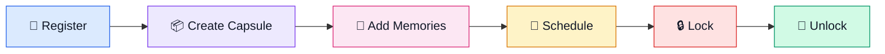
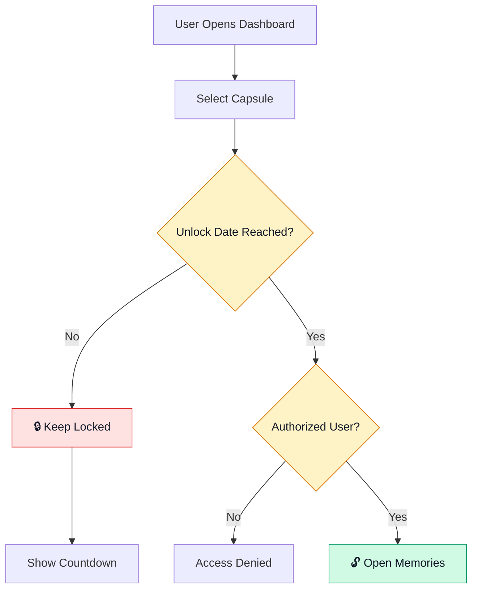
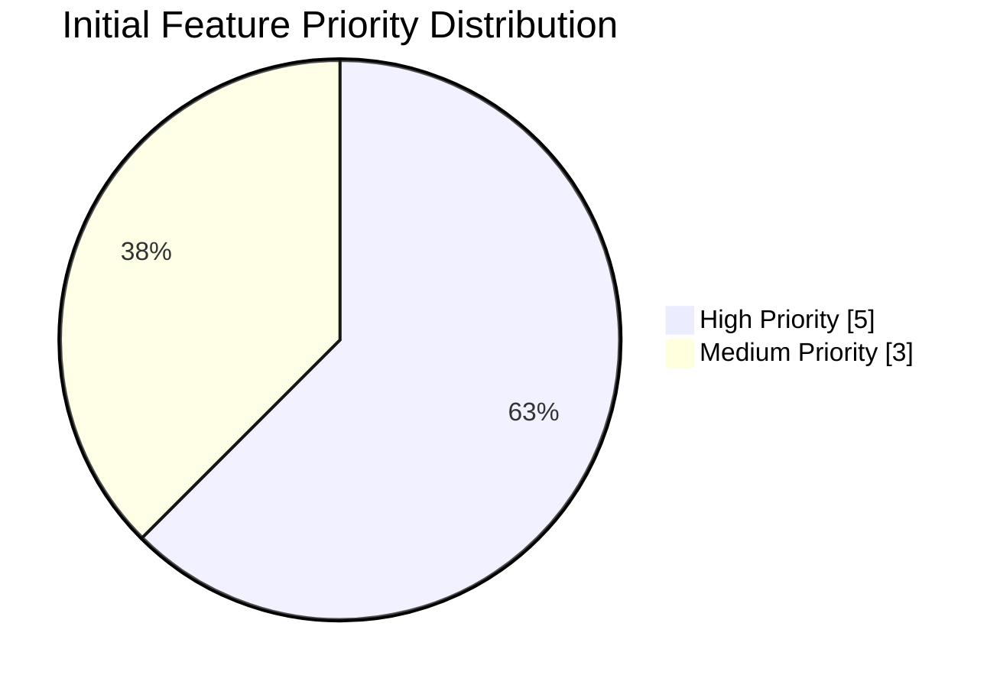
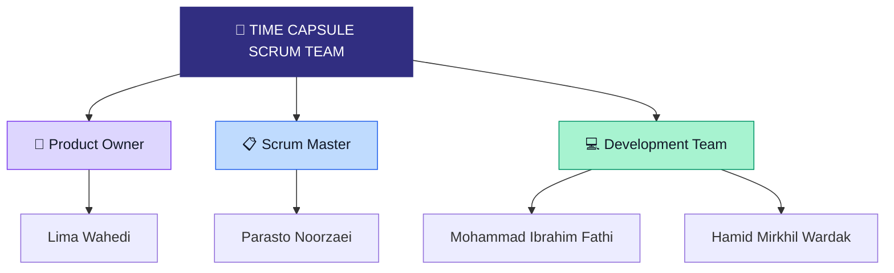
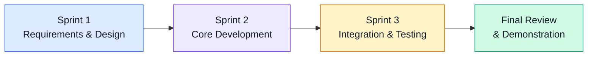

# ⏳ TIME CAPSULE
### 🌌 Digital Memories for the Future

**Preserve Today • Unlock Tomorrow • Relive Forever**

---

## 🌟 01 | PROJECT VISION

> What if you could send a memory to your future self?

**Time Capsule** is a web application that allows people to preserve precious memories and rediscover them in the future.

Users can create digital capsules containing messages, photos, and videos, select a future unlocking date, and securely store their memories until that day arrives.

### 🎯 Our Objectives

- Preserve meaningful digital memories.
- Create and manage personal time capsules.
- Schedule future unlocking dates.
- Protect locked capsules from early access.
- Enable sharing with authorized users.
- Provide countdowns and notifications.
- Build the system using Agile Scrum principles.

---

## 🔮 02 | HOW TIME CAPSULE WORKS

### 🔐 Unlocking Logic

---

## 📊 03 | FEATURE ANALYSIS

### Proposed Feature Priorities

| Feature | Description | Priority |
|:---|:---|:---:|
| 👤 Authentication | Registration and login | 🔴 High |
| 📦 Capsule Creation | Store digital memories | 🔴 High |
| 🔒 Capsule Locking | Prevent early access | 🔴 High |
| 📅 Unlock Scheduling | Choose a future date | 🔴 High |
| 🖥️ Dashboard | Manage capsules | 🔴 High |
| 👥 Sharing | Share with authorized users | 🟡 Medium |
| 🔔 Notifications | Unlock alerts | 🟡 Medium |
| ⏳ Countdown | Display remaining time | 🟡 Medium |

**Analysis:** Five of the eight proposed features are high priority because they form the core functionality of the application.

*These are proposed priorities, not completed development results.*

---

## 👥 04 | OUR SCRUM TEAM

### Team Responsibilities

| Member | Scrum Role | Responsibilities |
|---|---|---|
| Lima Wahedi | Product Owner | Vision, backlog, prioritization, stakeholder coordination |
| Parasto Noorzaei | Scrum Master | Scrum facilitation, meetings, impediments |
| Mohammad Ibrahim Fathi | Developer | Design, implementation, testing |
| Hamid Mirkhil Wardak | Developer | Design, implementation, testing |

---

## 🗓️ 05 | PROPOSED DEVELOPMENT ROADMAP

*The sprint count and roadmap are preliminary proposals pending team confirmation.*

---

## 📚 06 | SOFTWARE ENGINEERING DELIVERABLES

| Deliverable | Planned Documentation |
|---|---|
| Requirements Engineering | Functional and non-functional requirements |
| User Stories | 20 prioritized user stories |
| UML Modeling | Use case and sequence diagrams |
| Product Backlog | Standard Scrum backlog template |
| Sprint Backlogs | Sprint tasks and assignments |
| Burndown Charts | Actual sprint progress |
| Scrum Meetings | Agendas, minutes, and recordings |
| Development | Source code and testing evidence |
| Review | Sprint reviews and retrospectives |

---

## 💜 OUR PROJECT GOAL

**Build a secure, meaningful platform that transforms today's memories into tomorrow's discoveries.**

**Project:** Time Capsule – Digital Memories for the Future

**Methodology:** Agile Scrum

**Current Phase:** Initial Planning
