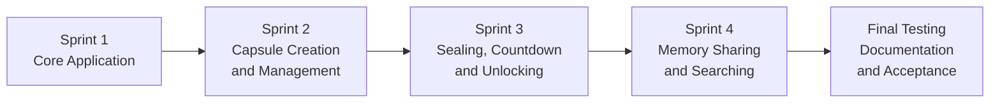

# 📁 Software Requirements Specification (SRS)
## Time Capsule – Digital Memories for the Future

**Course:** ITC 315 – Software Engineering  
**Methodology:** Agile Scrum  
**Prepared By:** Lima Wahedi – Product Owner  
**Team:** Group Project – Four Members  
**Date Updated:** November 3, 2026  
**Document Status:** Final – Project Development Completed  
**Development Sprints:** Sprint 1, Sprint 2, Sprint 3, Sprint 4

---

## 🎯 01 | Purpose

Time Capsule – Digital Memories for the Future is a web-based application designed to help users preserve personal memories and access them at a selected future date.

Users can create accounts, save memories, upload multimedia attachments, customize capsules, and schedule future unlocking.

The application also supports capsule management, countdowns, notifications, memory sharing, and searching.

This document defines the functional and non-functional requirements of the completed application.

---

## 👥 02 | Target Users

- Individuals who want to preserve personal memories.
- Students who want to save personal milestones.
- Families who want to store meaningful moments.
- Users who want to revisit memories in the future.
- People who want to share unlocked memories with authorized recipients.

---

## ⚙️ 03 | Functional Requirements

Functional requirements describe what the application must do.

| ID | Functional Requirement | Status |
|---|---|---|
| FR-01 | Users can register an account. | ✅ Working |
| FR-02 | Users can log in securely. | ✅ Working |
| FR-03 | Users can log out. | ✅ Working |
| FR-04 | Users can access a personal dashboard. | ✅ Working |
| FR-05 | Users can create private time capsules. | ✅ Working |
| FR-06 | Users can add capsule titles and messages. | ✅ Working |
| FR-07 | Users can upload photos and videos. | ✅ Working |
| FR-08 | Users can select a future unlock date and time. | ✅ Working |
| FR-09 | Users can save capsule drafts. | ✅ Working |
| FR-10 | Users can view saved capsules. | ✅ Working |
| FR-11 | Users can edit unlocked capsule drafts. | ✅ Working |
| FR-12 | Users can access capsules after unlocking. | ✅ Working |
| FR-13 | Users can customize capsule cover colors. | ✅ Working |
| FR-14 | Users can download attachments. | ✅ Working |
| FR-15 | Users can delete their own capsule drafts. | ✅ Working |
| FR-16 | Users can seal capsules to prevent early access. | ✅ Working |
| FR-17 | Users can view countdowns for sealed capsules. | ✅ Working |
| FR-18 | Capsules unlock at their scheduled date and time. | ✅ Working |
| FR-19 | Users can receive unlock notifications. | ✅ Implemented |
| FR-20 | Users can recover their account passwords. | ✅ Working |
| FR-21 | Users can share unlocked capsules with authorized recipients. | ✅ Working |
| FR-22 | Recipients can view shared capsules with appropriate permissions. | ✅ Working |
| FR-23 | Users can search capsules by title. | ✅ Working |
| FR-24 | The system stores account, capsule, and attachment data in the database. | ✅ Working |

**Functional Requirements Summary:** All listed functionality is reported as implemented. Individual verification results are documented in the Sprint Testing Reports.

---

## 🔐 04 | Non-Functional Requirements

Non-functional requirements describe how well the application should operate.

| ID | Category | Requirement |
|---|---|---|
| NFR-01 | Security | Passwords must be securely hashed. |
| NFR-02 | Privacy | Users must not access another user's private capsules without authorization. |
| NFR-03 | Usability | The interface should be simple and understandable. |
| NFR-04 | Compatibility | The application should work on modern web browsers. |
| NFR-05 | Responsiveness | Pages should adapt to mobile and desktop screens. |
| NFR-06 | Reliability | Saved information should remain available after restarting the application. |
| NFR-07 | Validation | Invalid form inputs should produce clear error messages. |
| NFR-08 | Maintainability | Code should be organized into understandable components. |
| NFR-09 | Data Integrity | Capsule information should be stored and retrieved accurately. |
| NFR-10 | Performance | Common pages should load within 3 seconds under normal test conditions. |
| NFR-11 | Access Control | Sharing permissions must prevent unauthorized access or modification. |
| NFR-12 | Time Integrity | Sealed capsules must remain inaccessible until their scheduled opening time. |
| NFR-13 | Session Security | Authentication sessions should be managed securely. |
| NFR-14 | Data Protection | File uploads and database operations should preserve the integrity of user information. |

**Verification Note:** Functional completion does not automatically prove every non-functional requirement. Performance, browser compatibility, responsiveness, and security requirements require their own testing evidence.

---

## ✅ 05 | Final Implementation Status

### Sprint 1 – Core Application

- User registration
- Secure login
- User logout
- Initial dashboard
- Database connection
- Basic application interface

**Status:** ✅ Completed

### Sprint 2 – Capsule Creation and Management

- Private capsule creation
- Capsule titles and messages
- Three cover color options
- Image attachment uploads
- Video attachment uploads
- Saved capsule drafts
- Draft editing
- Attachment preservation during editing
- Attachment downloading
- Draft deletion with confirmation
- Ownership and access checks
- Password hashing and CSRF protection
- Capsule and attachment database integration
- Functional testing
- Product Owner acceptance

**Status:** ✅ Completed – 15/15 Tasks

### Sprint 3 – Sealing and Scheduled Unlocking

- Future opening date and time
- Capsule sealing
- Early-access prevention
- Live countdown
- Scheduled unlocking
- Compatibility with existing accounts and drafts
- Functional and regression testing

**Status:** ✅ Completed – 7/7 Tasks

### Sprint 4 – Sharing and Searching

- Sprint requirement review
- Memory sharing
- Recipient access
- Read-only permissions
- Sharing security controls
- Capsule title search
- Sequence diagram documentation
- Source code and documentation uploads
- Functional testing
- Product Owner acceptance

**Status:** ✅ Completed – 10/10 Tasks

### Final Feature Updates

- Unlock notification feature implemented
- Password recovery reported completed
- Memory sharing tested successfully
- Capsule searching tested successfully

**Overall Development Status:** ✅ Completed

---

## 🗺️ 06 | Completed Development Roadmap

The project was developed using four Scrum sprints.

| Sprint | Main Focus | Completion |
|---|---|---|
| Sprint 1 | Registration, login, dashboard, and initial database | Completed |
| Sprint 2 | Capsule creation, attachments, editing, and deletion | Completed |
| Sprint 3 | Sealing, countdown, and scheduled unlocking | Completed |
| Sprint 4 | Sharing, permissions, and title searching | Completed |
| Final Review | Testing, documentation, and submission preparation | Final verification |

---

## 📌 07 | Requirements Validation

Requirements validation was coordinated by the Product Owner with the Scrum team.

The validation process included:

1. Reviewing requirements against the Product Backlog.
2. Mapping sprint tasks to corresponding user stories.
3. Reviewing implemented functionality.
4. Checking the Sprint Testing Reports.
5. Reviewing security and access-control requirements.
6. Confirming completed deliverables.
7. Recording remaining verification notes where necessary.

The Product Backlog and Sprint Backlogs provide traceability between user needs and development tasks.

---

## 🧪 08 | Testing and Verification

Testing documentation is organized by sprint.

| Sprint | Testing Scope | Report |
|---|---|---|
| Sprint 1 | Registration, login, and initial functionality | Sprint-1-Testing-Report.md |
| Sprint 2 | Capsule creation, attachments, management, and security | Sprint-2-Testing-Report.md |
| Sprint 3 | Sealing, countdown, unlocking, and regression testing | Sprint-3-Testing-Report.md |
| Sprint 4 | Sharing, searching, permissions, and regression testing | Sprint-4-Testing-Report.md |

Test cases, outcomes, and acceptance details are recorded in the respective reports under `04-Development`.

---

## 👥 09 | Scrum Team Responsibilities

| Team Member | Scrum Role | Main Responsibility |
|---|---|---|
| Lima Wahedi | Product Owner | Requirements, user stories, backlog priorities, documentation review, and acceptance |
| Parasto Noorzaei | Scrum Master | Scrum coordination, meetings, progress tracking, and impediment management |
| Mohammad Ibrahim Fathi | Developer | Backend development, database integration, testing, and code contributions |
| Hamid Mirkhil Wardak | Developer | Frontend development, templates, interface improvements, testing, and code contributions |

---

## 📂 10 | Related Project Documentation

- Project Overview
- Team Structure
- Scrum Framework
- Product Backlog
- Sprint 1–4 Backlogs
- Use Case Diagram
- Sequence Diagrams
- Sprint 1–4 Reports
- Sprint 1–4 Testing Reports
- Burndown Charts
- Daily Standups
- Sprint Planning
- Sprint Reviews and Retrospectives
- Meeting Recordings
- Development Source Code

---

## 🏁 11 | Final Requirements Summary

Time Capsule – Digital Memories for the Future has completed its four planned development sprints.

The application provides account management, capsule creation, multimedia storage, scheduled unlocking, notifications, sharing, and searching.

Development completion and test results are recorded in the corresponding Scrum artifacts.

**Project Development:** Completed  
**Scrum Sprints:** 4  
**Product Owner:** Lima Wahedi  
**Document Version:** Final – November 3, 2026
