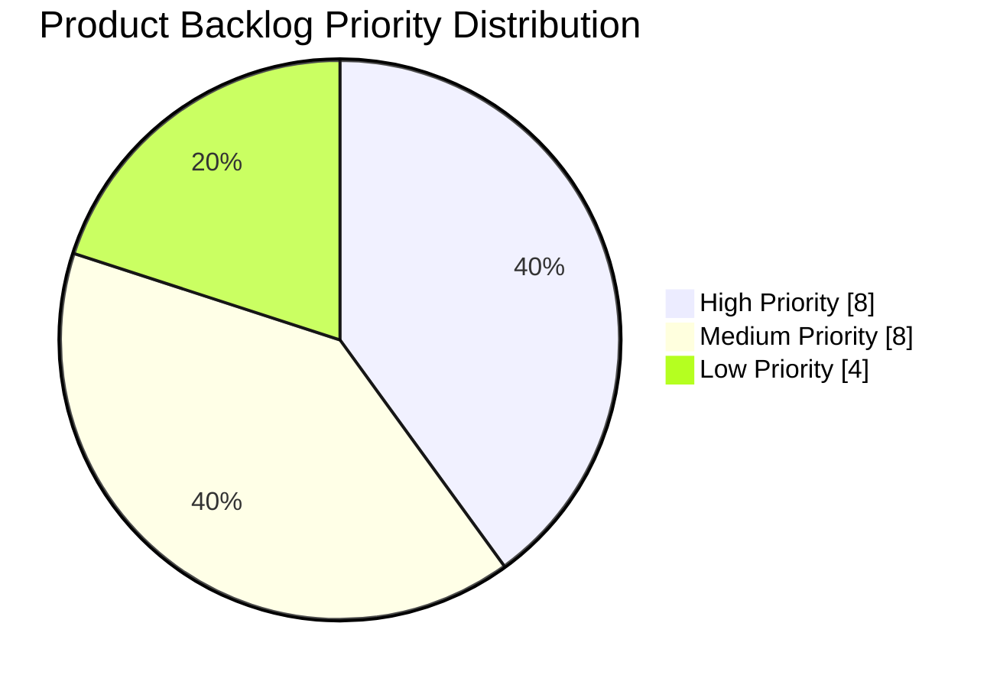
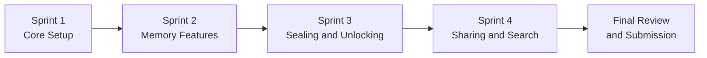

# 📋 Product Backlog
## Time Capsule – Digital Memories for the Future

**Course:** ITC 315 – Software Engineering  
**Methodology:** Agile Scrum  
**Product Owner:** Lima Wahedi  
**Scrum Master:** Parasto Noorzaei  
**Developers:** Mohammad Ibrahim Fathi and Hamid Mirkhil Wardak  
**Last Updated:** November 3, 2026  
**Status:** Final Product Backlog – Development Completed

---

## 🎯 01 | Product Goal

The goal of Time Capsule – Digital Memories for the Future is to provide a secure, user-friendly web application where individuals can preserve memories and access them at a chosen future date.

The application allows users to create accounts, create and manage capsules, attach multimedia files, schedule unlocking, receive notifications, and share unlocked memories with authorized recipients.

---

## 📊 02 | Product Backlog – 20 User Stories

### 🔴 High Priority User Stories

| ID | User Story | Priority | Status |
|---|---|---|---|
| US-01 | As a user, I want to register an account so I can securely store my memories. | High | ✅ Completed |
| US-02 | As a user, I want to log in securely so I can access my personal capsules. | High | ✅ Completed |
| US-03 | As a user, I want to log out so I can protect my account. | High | ✅ Completed |
| US-04 | As a user, I want to create a private time capsule so I can preserve memories. | High | ✅ Completed |
| US-05 | As a user, I want to write messages inside my capsule so I can remember important experiences. | High | ✅ Completed |
| US-06 | As a user, I want to select a future opening date so I can revisit memories later. | High | ✅ Completed |
| US-07 | As a user, I want my capsule to remain sealed until its opening date so my memories stay protected. | High | ✅ Completed |
| US-08 | As a user, I want to view my capsules on a dashboard so I can manage them easily. | High | ✅ Completed |

### 🟡 Medium Priority User Stories

| ID | User Story | Priority | Status |
|---|---|---|---|
| US-09 | As a user, I want to upload photos so I can preserve visual memories. | Medium | ✅ Completed |
| US-10 | As a user, I want to upload videos so I can save special moments. | Medium | ✅ Completed |
| US-11 | As a user, I want to edit an unlocked draft capsule so I can correct mistakes. | Medium | ✅ Completed |
| US-12 | As a user, I want to delete my own capsules so I can manage unwanted content. | Medium | ✅ Completed |
| US-13 | As a user, I want to see a countdown so I know when my capsule will unlock. | Medium | ✅ Completed |
| US-14 | As a user, I want to receive an unlock notification so I know when my memories are available. | Medium | ✅ Completed |
| US-15 | As a user, I want to recover my password so I can regain account access. | Medium | ✅ Completed |
| US-16 | As a user, I want to open my capsule after its unlock date so I can revisit my memories. | Medium | ✅ Completed |

### 🟢 Low Priority User Stories

| ID | User Story | Priority | Status |
|---|---|---|---|
| US-17 | As a user, I want to give my capsule a title so I can recognize it easily. | Low | ✅ Completed |
| US-18 | As a user, I want to customize my capsule appearance so it feels personal. | Low | ✅ Completed |
| US-19 | As a user, I want to share an unlocked capsule with authorized people so we can revisit memories together. | Low | ✅ Completed |
| US-20 | As a user, I want to search my capsules by title so I can find memories quickly. | Low | ✅ Completed |

---

## 📈 03 | Product Backlog Summary

| Priority | Number of Stories | Percentage |
|---|---:|---:|
| 🔴 High | 8 | 40% |
| 🟡 Medium | 8 | 40% |
| 🟢 Low | 4 | 20% |
| **Total** | **20** | **100%** |

### Priority Distribution

### Completion Summary

| Category | Result |
|---|---|
| Total User Stories | 20 |
| Completed User Stories | 20 |
| Incomplete User Stories | 0 reported |
| Completion Percentage | 100% |
| Development Sprints | 4 |

**Product Backlog Status:** All 20 user stories are recorded as completed following the team's final development updates.

---

## 🔗 04 | Sprint-to-User-Story Traceability

The following table connects Product Backlog requirements with the Sprint Backlogs.

| Sprint | User Stories / Supporting Work | Main Deliverables |
|---|---|---|
| Sprint 1 | US-01, US-02, US-03, US-08 | Registration, login, logout, initial dashboard |
| Sprint 2 | US-04, US-05, US-08, US-09, US-10, US-11, US-12, US-17, US-18 | Capsule creation, multimedia, draft management |
| Sprint 3 | US-06, US-07, US-13, US-16 | Sealing, countdown, scheduled unlocking |
| Sprint 4 | US-19, US-20 | Memory sharing, recipient permissions, searching |
| Final Integration | US-14, US-15 and regression checks | Notifications, password recovery, final verification |

**Note:** Final integration records US-14 and US-15 without assigning them to an unsupported sprint. Their actual implementation history can be confirmed through the development commits and meeting records.

---

## 🗺️ 05 | Completed Development Roadmap

The project followed four development sprints, followed by final testing and submission preparation.

| Phase | Main Activities | Status |
|---|---|---|
| Sprint 1 | Account registration, login, logout, dashboard, database | ✅ Completed |
| Sprint 2 | Capsule creation, messages, attachments, drafts, editing, deletion | ✅ Completed |
| Sprint 3 | Future dates, sealing, countdown, scheduled unlocking | ✅ Completed |
| Sprint 4 | Sharing, recipient access, title searching, documentation | ✅ Completed |
| Final Integration | Notifications, password recovery, regression verification | ✅ Development Completed |
| Final Review | Testing reports, GitHub documentation, submission | Final review |

---

## 📦 06 | Sprint Completion Summary

| Sprint | Backlog Tasks | Completion |
|---|---|---|
| Sprint 1 | Core application tasks | Completed |
| Sprint 2 | 15/15 | 100% |
| Sprint 3 | 7/7 | 100% |
| Sprint 4 | 10/10 | 100% |

Sprint Backlogs, Sprint Reports, and Testing Reports provide detailed evidence of the completed work.

---

## 🧪 07 | Testing and Acceptance

The Scrum team tested the implemented functionality throughout development.

### Sprint 1
- Registration and login
- Basic interface
- Database connection

### Sprint 2
- Capsule creation
- Multimedia attachments
- Draft management
- Editing and deletion
- Security and database integration

### Sprint 3
- Opening dates
- Sealing
- Countdown
- Unlocking
- Regression testing

### Sprint 4
- Sharing functionality
- Recipient permissions
- Capsule searching
- Regression testing

### Final Integration
- Unlock notification feature
- Password recovery
- Final compatibility checks

**Testing Documentation:** See the Sprint 1–4 Testing Reports.

**Product Owner Review:** Completed sprint deliverables were reviewed against the backlog and acceptance criteria.

---

## 👥 08 | Scrum Responsibilities

| Team Member | Role | Main Responsibility |
|---|---|---|
| Lima Wahedi | Product Owner | Define user stories, prioritize backlog, review features, accept deliverables |
| Parasto Noorzaei | Scrum Master | Coordinate meetings, track blockers, support Scrum practices |
| Mohammad Ibrahim Fathi | Developer | Backend implementation, database integration, testing, code commits |
| Hamid Mirkhil Wardak | Developer | Frontend implementation, templates, interface testing, code commits |

---

## 🔄 09 | Backlog Maintenance and Updates

During the project, the Product Owner:

1. Created and prioritized 20 user stories.
2. Maintained the Product Backlog.
3. Coordinated user story assignments with Sprint Backlogs.
4. Updated story statuses according to development progress.
5. Reviewed completed sprint deliverables.
6. Maintained traceability between requirements and implementation.
7. Followed up with developers about outstanding features.
8. Updated the backlog following final development confirmations.

The Product Backlog was updated to reflect all four development sprints and the final integration work.

---

## 📁 10 | Supporting Scrum Artifacts

The repository contains supporting documentation including:

- Project Overview
- Team Structure
- Scrum Framework
- Functional and Non-Functional Requirements
- Sprint 1–4 Backlogs
- Sprint 1–4 Reports
- Sprint 1–4 Testing Reports
- Use Case Diagram
- Sequence Diagrams
- Burndown Charts
- Daily Standups
- Sprint Planning
- Sprint Reviews and Retrospectives
- Meeting Recordings
- Development Source Code

---

## 🏁 11 | Final Product Backlog Review

The Time Capsule – Digital Memories for the Future project has completed four development sprints.

All 20 user stories are marked as completed based on the team's final updates.

The Product Owner maintained the backlog, coordinated requirements, reviewed deliverables, and documented sprint progress.

**Total User Stories:** 20  
**Completed:** 20  
**Completion:** 100%  
**Development Status:** Completed  
**Product Owner:** Lima Wahedi  
**Last Updated:** November 3, 2026
