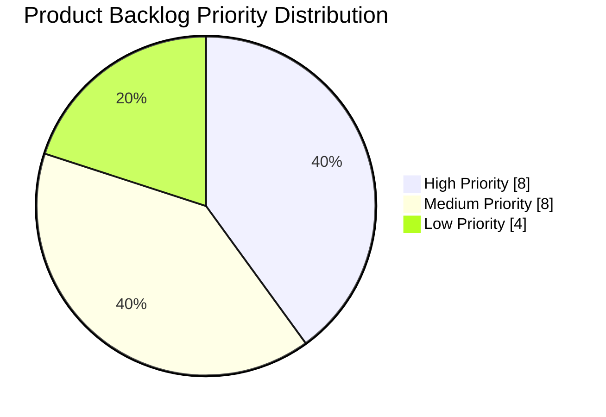
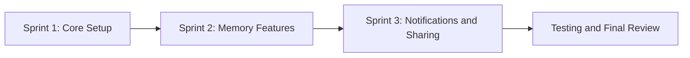

# 📋 TIME CAPSULE | PRODUCT BACKLOG

### Digital Memories for the Future

**Course:** ITC 315 – Software Engineering

**Product Owner:** Lima Wahedi

**Methodology:** Agile Scrum

**Status:** Initial Backlog Planning

---

## 🎯 Product Goal

Develop a digital platform where users can create
time capsules, store memories, select future unlock
dates, and revisit their memories when the time arrives.

---

## 📊 Product Backlog

The backlog contains 20 prioritized user stories
covering the main features of the Time Capsule system.

## 📊 20 Prioritized User Stories

| ID | User Story | Priority | Status |
|---|---|---|---|
| US-01 | As a user, I want to register an account so I can save my memories securely. | 🔴 High | To Do |
| US-02 | As a user, I want to log in so I can access my personal capsules. | 🔴 High | To Do |
| US-03 | As a user, I want to log out so I can protect my account. | 🔴 High | To Do |
| US-04 | As a user, I want to create a time capsule so I can preserve memories. | 🔴 High | To Do |
| US-05 | As a user, I want to write messages inside my capsule so I can read them in the future. | 🔴 High | To Do |
| US-06 | As a user, I want to choose an unlock date so my capsule opens at the right time. | 🔴 High | To Do |
| US-07 | As a user, I want my capsule to remain locked before its unlock date so my memories stay private. | 🔴 High | To Do |
| US-08 | As a user, I want to view my capsules on a dashboard so I can manage them easily. | 🔴 High | To Do |
| US-09 | As a user, I want to upload photos so I can preserve visual memories. | 🟡 Medium | To Do |
| US-10 | As a user, I want to upload videos so I can save special moments. | 🟡 Medium | To Do |
| US-11 | As a user, I want to edit an unlocked draft capsule so I can correct mistakes. | 🟡 Medium | To Do |
| US-12 | As a user, I want to delete my own capsules so I can manage unwanted content. | 🟡 Medium | To Do |
| US-13 | As a user, I want to see a countdown so I know when my capsule will unlock. | 🟡 Medium | To Do |
| US-14 | As a user, I want to receive an unlock notification so I know when my memories are available. | 🟡 Medium | To Do |
| US-15 | As a user, I want to recover my password so I can regain account access. | 🟡 Medium | To Do |
| US-16 | As a user, I want to open my capsule after its unlock date so I can revisit my memories. | 🟡 Medium | To Do |
| US-17 | As a user, I want to give my capsule a title so I can recognize it easily. | 🟢 Low | To Do |
| US-18 | As a user, I want to customize my capsule appearance so it feels personal. | 🟢 Low | To Do |
| US-19 | As a user, I want to share an unlocked capsule with authorized people so we can revisit memories together. | 🟢 Low | To Do |
| US-20 | As a user, I want to search my capsules by title so I can find memories quickly. | 🟢 Low | To Do |

---

## 📈 Feature Priority Analysis

| Priority | Stories | Percentage |
|---|---:|---:|
| 🔴 High | 8 | 40% |
| 🟡 Medium | 8 | 40% |
| 🟢 Low | 4 | 20% |
| **Total** | **20** | **100%** |

---

## 🚀 Proposed Development Roadmap

**Note:** Sprint assignments and implementation status will be updated after confirmation with the development team.

---

## 👥 Scrum Responsibilities

| Team Member | Role | Main Responsibility |
|---|---|---|
| Lima Wahedi | Product Owner | Define user stories, prioritize backlog, review features |
| Parasto Noorzaei | Scrum Master | Coordinate meetings, track blockers, support Scrum |
| Mohammad Ibrahim Fathi | Developer | Implement assigned features, test and commit code |
| Hamid Mirkhil Wardak | Developer | Implement assigned features, test and commit code |

---

## 🔄 Backlog Maintenance

- Review priorities during sprint planning.
- Move selected stories into the Sprint Backlog.
- Update story status based on actual development progress.
- Record changes and decisions in GitHub.
- Review completed features during Sprint Review.
