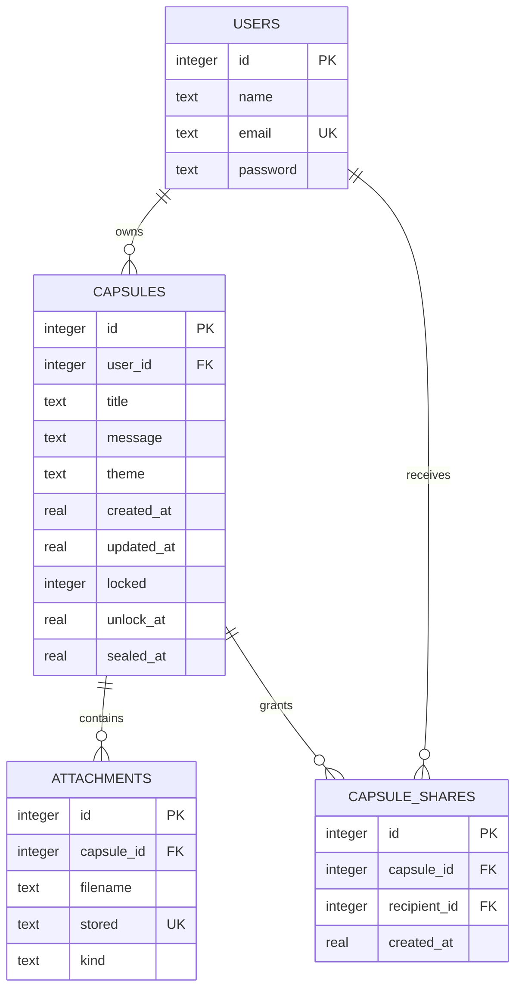

# Sprint 4 database model

UNIQUE(capsule_id, recipient_id) prevents duplicate shares. Foreign keys protect references. Recipient index supports lookup. The capsule owner does not change when a share is added. The new table is added with CREATE TABLE IF NOT EXISTS; no existing data is reset.
