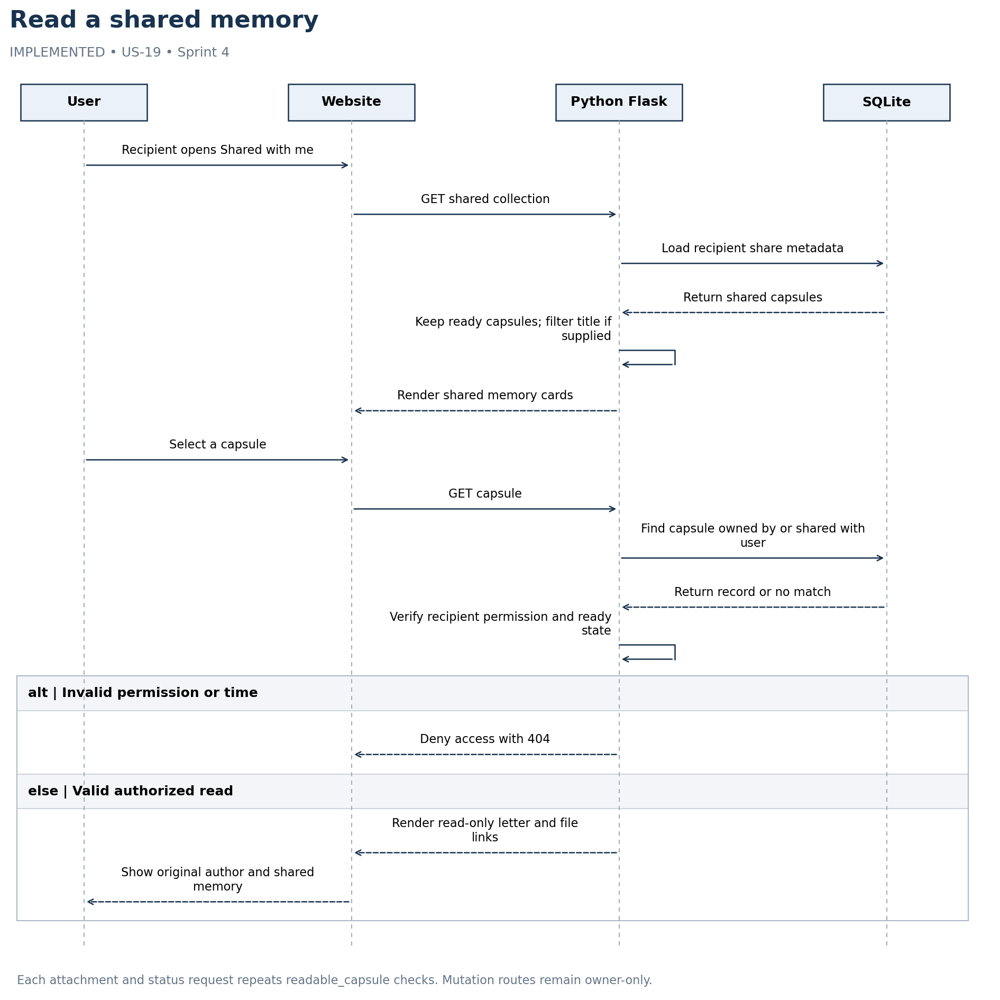

# Read a shared memory

IMPLEMENTED • US-19 • Sprint 4



Each attachment and status request repeats readable_capsule checks. Mutation routes remain owner-only.

## Editable Mermaid source

```mermaid
sequenceDiagram
    actor User
    participant UI as Website
    participant App as Python Flask
    participant DB as SQLite
    User->>UI: Recipient opens Shared with me
    UI->>App: GET shared collection
    App->>DB: Load recipient share metadata
    DB-->>App: Return shared capsules
    App->>App: Keep ready capsules; filter title if supplied
    App-->>UI: Render shared memory cards
    User->>UI: Select a capsule
    UI->>App: GET capsule
    App->>DB: Find capsule owned by or shared with user
    DB-->>App: Return record or no match
    App->>App: Verify recipient permission and ready state
    alt Invalid permission or time
    App-->>UI: Deny access with 404
    else Valid authorized read
    App-->>UI: Render read-only letter and file links
    UI-->>User: Show original author and shared memory
    end
```
