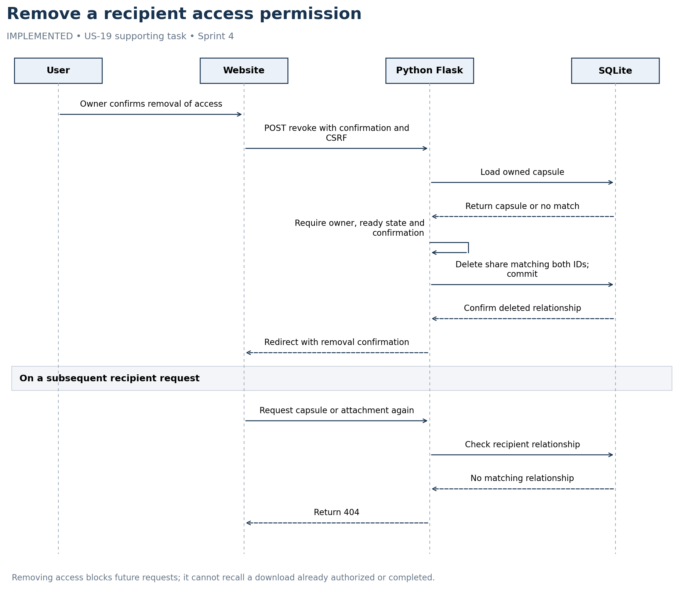

# Remove a recipient access permission

IMPLEMENTED • US-19 supporting task • Sprint 4



Removing access blocks future requests; it cannot recall a download already authorized or completed.

## Editable Mermaid source

```mermaid
sequenceDiagram
    actor User
    participant UI as Website
    participant App as Python Flask
    participant DB as SQLite
    User->>UI: Owner confirms removal of access
    UI->>App: POST revoke with confirmation and CSRF
    App->>DB: Load owned capsule
    DB-->>App: Return capsule or no match
    App->>App: Require owner, ready state and confirmation
    App->>DB: Delete share matching both IDs; commit
    DB-->>App: Confirm deleted relationship
    App-->>UI: Redirect with removal confirmation
    Note over User,DB: On a subsequent recipient request
    UI->>App: Request capsule or attachment again
    App->>DB: Check recipient relationship
    DB-->>App: No matching relationship
    App-->>UI: Return 404
```
