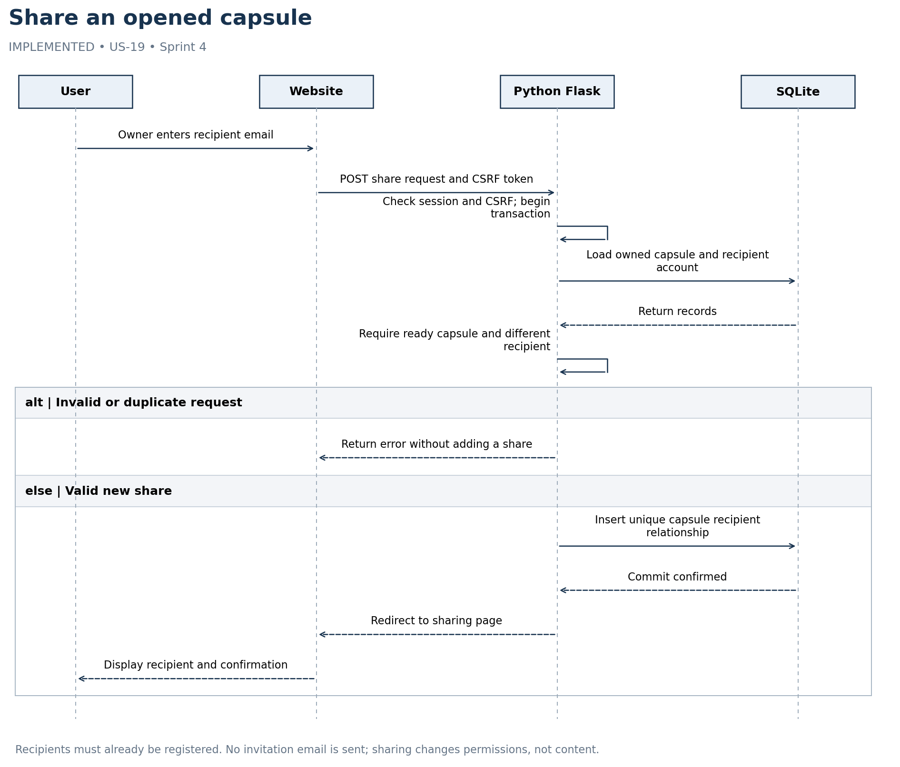

# Share an opened capsule

IMPLEMENTED • US-19 • Sprint 4



Recipients must already be registered. No invitation email is sent; sharing changes permissions, not content.

## Editable Mermaid source

```mermaid
sequenceDiagram
    actor User
    participant UI as Website
    participant App as Python Flask
    participant DB as SQLite
    User->>UI: Owner enters recipient email
    UI->>App: POST share request and CSRF token
    App->>App: Check session and CSRF; begin transaction
    App->>DB: Load owned capsule and recipient account
    DB-->>App: Return records
    App->>App: Require ready capsule and different recipient
    alt Invalid or duplicate request
    App-->>UI: Return error without adding a share
    else Valid new share
    App->>DB: Insert unique capsule recipient relationship
    DB-->>App: Commit confirmed
    App-->>UI: Redirect to sharing page
    UI-->>User: Display recipient and confirmation
    end
```
