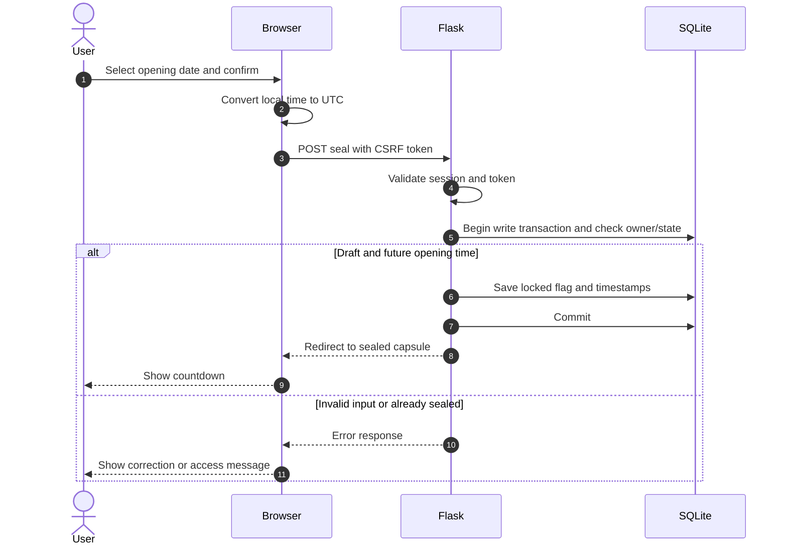
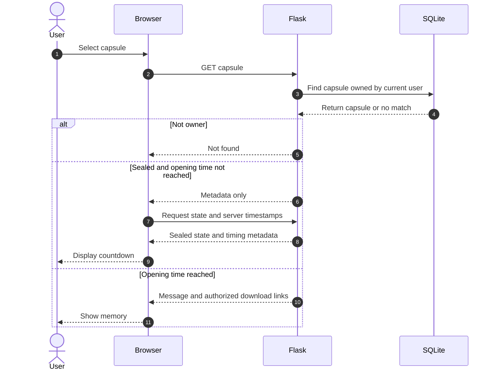

# Sprint 3 sequence diagrams

## Choose a time and seal a draft

## Open a capsule

Every attachment download independently checks ownership and time. A countdown reaching zero requests confirmation from the server before reloading the memory.
